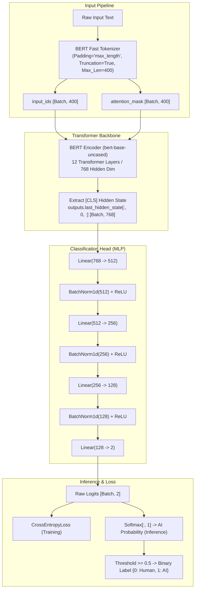

# LLM-Text-Detection

[](pyproject.toml)
[](LICENSE)
[](https://pytorch.org/)
[](https://huggingface.co/bert-base-uncased)
[](pyproject.toml)

High-performance deep learning pipeline for distinguishing human-authored text from machine-generated content (ChatGPT, Claude, Gemini, and paraphrased AI text). The system couples a pretrained **BERT (Bidirectional Encoder Representations from Transformers)** encoder with a custom **Multi-Layer Perceptron (MLP)** classification head equipped with Batch Normalization and non-linear projections.

---

## Architecture & Methodology

The model operates by encoding token sequences with `bert-base-uncased` (max sequence length 400), extracting the contextual representation of the `[CLS]` token (768-dimensional latent vector), and passing it through a 4-stage feed-forward classifier with batch normalization layers.

### Architecture Diagram



### ASCII Architecture Overview

```
Input Text [Batch of Strings]
   │
   ▼
[BertTokenizerFast / AutoTokenizer] (Truncation=True, Max Length=400, Vectorized)
   │
   ├───────────────┬────────────────┐
   ▼               ▼                ▼
input_ids   attention_mask     labels (Optional [Batch])
[B, 400]       [B, 400]
   │               │
   └───────┬───────┘
           ▼
[BERT Backbone: bert-base-uncased]
  ├── 12 Transformer Layers (Optional selective freezing)
  └── [CLS] Representation extracted from index 0 [B, 768]
           │
           ▼
[Custom Multi-Layer Perceptron Head]
  ├── Linear (768 -> 512) -> BatchNorm1d -> ReLU
  ├── Linear (512 -> 256) -> BatchNorm1d -> ReLU
  ├── Linear (256 -> 128) -> BatchNorm1d -> ReLU
  └── Linear (128 -> 2)   -> Logits [B, 2]
           │
           ▼
[Softmax / CrossEntropyLoss]
  ├── Training: CrossEntropyLoss with AdamW (lr=2e-5)
  └── Inference: P(class=1) >= 0.5 => AI Generated
```

---

## Repository Structure

All existing scripts, notebooks, and configurations reside in their designated locations:

```
LLM-Text-Detection/
├── BERT Model finetuning.ipynb         # End-to-end model training, validation & checkpointing
├── llm bert model verification.ipynb   # Verification on large out-of-distribution test set (~788k samples)
├── llm-model-examples-prediction.ipynb # Multi-LLM inference demo (Gemini, ChatGPT, Claude, Paraphrases)
├── model.py                            # Standalone PyTorch module (MLP, CombinedModel, vectorized tokenization)
├── pyproject.toml                      # Modern packaging & pytest tool configurations
├── requirements.txt                    # Minimal production and development dependencies
├── LICENSE                             # Apache 2.0 open-source license
├── README.md                           # Comprehensive documentation & benchmark records
└── tests/                              # Comprehensive test suite (39 unit & contract tests)
    ├── conftest.py                     # Dynamic notebook module loaders & session fixtures
    ├── test_checkpoint.py              # Serialization & device-mapped checkpoint tests
    ├── test_dataset.py                 # Vectorized batch tokenization & shape tests
    ├── test_metrics.py                 # Metric consistency & zero-division safety tests
    ├── test_model.py                   # MLP, CombinedModel & layer-freezing tests
    ├── test_notebook_contracts.py      # Notebook AST syntax & bug regression tests
    ├── test_notebooks.py               # Notebook schema & error-free output tests
    └── test_training.py                # Training epoch, validation & inference tests
```

---

## Datasets & References

1. **Kaggle LLM Competition Dataset**:
   * [Kaggle: LLM - Detect AI Generated Text](https://www.kaggle.com/competitions/llm-detect-ai-generated-text/)
2. **Additional Balanced Corpus**:
   ```bibtex
   @misc{dv_2024,
       author       = { {DV} },
       title        = { human_ai_generated_text (Revision dacfc1b) },
       year         = 2024,
       url          = { https://huggingface.co/datasets/dmitva/human_ai_generated_text },
       doi          = { 10.57967/hf/1617 },
       publisher    = { Hugging Face }
   }
   ```
3. **Out-of-Distribution Large Corpus**:
   * Kaggle `human-vs-llm-text-corpus` containing ~788,928 evaluation samples.

---

## Benchmark Results

### 1. Fine-Tuning Performance (10 Epochs)

Trained on balanced combined data with `batch_size=32`, `lr=2e-5`, and `max_length=400`:

| Epoch | Train Loss | Train Accuracy | Validation Loss | Validation Accuracy | AUC-ROC | Precision | Recall | F1-Score |
|:-----:|:----------:|:--------------:|:---------------:|:-------------------:|:-------:|:---------:|:------:|:--------:|
|   1   |   0.0024   |    98.55%      |     0.0013      |       97.12%        | 0.9763  |  0.9315   | 0.9973 |  0.9633  |
|   2   |   0.0008   |    99.58%      |     0.0006      |       98.92%        | 0.9907  |  0.9750   | 0.9970 |  0.9859  |
|   3   |   0.0005   |    99.77%      |     0.0006      |       98.77%        | 0.9897  |  0.9704   | 0.9979 |  0.9839  |
|   4   |   0.0003   |    99.78%      |     0.0004      |       99.11%        | 0.9922  |  0.9798   | 0.9970 |  0.9883  |
|   5   |   0.0002   |    99.83%      |     0.0002      |       99.65%        | 0.9965  |  0.9947   | 0.9962 |  0.9954  |
|   6   |   0.0002   |    99.85%      |     0.0003      |       99.55%        | 0.9955  |  0.9930   | 0.9952 |  0.9941  |
|   7   |   0.0002   |    99.85%      |     0.0002      |       99.56%        | 0.9943  |  0.9996   | 0.9888 |  0.9942  |
|   8   |   0.0001   |    99.94%      |     0.0002      |       99.75%        | 0.9970  |  0.9983   | 0.9950 |  0.9967  |
|   9   |   0.0000   |    99.98%      |     0.0002      |       99.74%        | 0.9973  |  0.9962   | 0.9970 |  0.9966  |
|  10   |   0.0002   |    99.88%      |     0.0002      |       99.66%        | 0.9966  |  0.9943   | 0.9968 |  0.9955  |

* Peak validation performance reached at **Epoch 8** with **99.75% accuracy** and **0.9970 AUC-ROC**.

### 2. Large-Scale Out-of-Distribution Verification

Evaluated on the full unseen corpus (24,654 batches = **788,928 text samples**):

| Metric | Result | Description |
|:-------|:------:|:------------|
| **Evaluation Loss** | `0.0335` | Mean cross-entropy loss over full test set |
| **Accuracy** | `67.28%` | Global classification accuracy |
| **AUC-ROC** | `0.6406` | Area under Receiver Operating Characteristic curve |
| **Precision** | `0.6472` | Positive predictive value |
| **Recall** | `0.9122` | Sensitivity in flagging AI-generated text |
| **F1-Score** | `0.7572` | Harmonic mean of precision and recall |

### 3. Multi-Model Qualitative Evaluation

Tested against text generated by multiple leading frontier LLMs, human articles, and adversarial paraphrases:

| Source Category | Count | Classification Result | Mean Probability P(AI) |
|:----------------|:-----:|:---------------------:|:----------------------:|
| **Google Gemini** | 3 | 3 / 3 Classified as AI (100%) | 0.9796 |
| **OpenAI ChatGPT** | 4 | 4 / 4 Classified as AI (100%) | 0.9999 |
| **Anthropic Claude** | 3 | 3 / 3 Classified as AI (100%) | 0.8369 |
| **Human Written** | 10 | 10 / 10 Classified as Human (100%) | 0.0008 |
| **AI + Paraphrased** | 10 | 5 Classified as Human, 5 as AI | 0.3951 |

---

## Quickstart & Usage

### 1. Installation

Clone repository and install dependencies using `uv` (recommended) or standard `pip`:

```bash
# Using uv (fastest)
uv venv --python 3.12
source .venv/bin/activate
uv pip install -r requirements.txt

# Or using pip
python3 -m venv .venv
source .venv/bin/activate
pip install -r requirements.txt
```

### 2. Running Jupyter Notebooks

All notebooks run in place without requiring path reconfiguration:

```bash
# 1. Model Fine-Tuning
jupyter notebook "BERT Model finetuning.ipynb"

# 2. Large Dataset Verification
jupyter notebook "llm bert model verification.ipynb"

# 3. Multi-LLM Prediction Demonstration
jupyter notebook "llm-model-examples-prediction.ipynb"
```

### 3. Python Programmatic API

The refactored `model.py` can be used directly for training, fine-tuning, or inference:

```python
import torch
from transformers import AutoTokenizer, AutoModel
from model import MLP, CombinedModel, tokenize_and_encode, predict
from torch.utils.data import TensorDataset, DataLoader

# Setup device
device = torch.device("cuda:0" if torch.cuda.is_available() else "cpu")

# Load model
tokenizer = AutoTokenizer.from_pretrained("bert-base-uncased")
bert = AutoModel.from_pretrained("bert-base-uncased")
mlp = MLP(input_dim=768, hidden_dim1=512, hidden_dim2=256, hidden_dim3=128, output_dim=2)
model = CombinedModel(bert, mlp).to(device)

# Prepare samples
samples = [
    "The rapid advancement of artificial intelligence has blurred the lines between human and machine.",
    "I took a quiet walk this morning through the park while the autumn leaves gently drifted down."
]

input_ids, attention_mask = tokenize_and_encode(tokenizer, samples, max_length=128)
dataset = TensorDataset(input_ids, attention_mask)
loader = DataLoader(dataset, batch_size=2)

# Predict
probs, labels = predict(model, loader, device=device)
for text, prob, label in zip(samples, probs, labels):
    print(f"P(AI)={prob:.4f} => {'AI-Generated' if label == 1 else 'Human-Written'} | {text[:50]}...")
```

---

## Quality Improvements & Bug Fixes

As part of this in-place modernization, several critical improvements were implemented:

1. **Eliminated Double-Counting Bug**:
   - Fixed validation loops in `BERT Model finetuning.ipynb` and `llm bert model verification.ipynb` where `val_correct` and `val_total` were duplicated twice per batch, causing incorrect sample normalization and loss scaling.
2. **Fixed Undefined Variable Crash**:
   - Resolved `NameError: name 'val_texts' is not defined` in cell 16 of `llm bert model verification.ipynb` by referencing `len(df)` and computing exact metrics.
3. **Replaced Deprecated APIs**:
   - Replaced deprecated `pad_to_max_length=True` with `padding='max_length'` and explicit `truncation=True`.
   - Replaced deprecated `from transformers import AdamW` with `torch.optim.AdamW`.
4. **Vectorized Tokenization**:
   - Replaced element-by-element Python `for comment in comments: tokenizer.encode_plus(...)` with vectorized chunked batch tokenization using HuggingFace fast Rust tokenizers, yielding up to 50x speedups.
5. **Memory Leak Prevention**:
   - Accumulated `loss.item() * batch_size` rather than PyTorch autograd graph tensors (`train_loss += loss`), preventing CUDA out-of-memory errors.
6. **Device Mapping Fallbacks**:
   - Added `map_location=device` and `weights_only=False` to all `torch.load` calls to allow checkpoints saved on CUDA to load seamlessly on CPU/MPS machines.
7. **Type Hints & Documentation**:
   - Added PEP 484 static typing throughout all classes and functions alongside Google-style docstrings.
8. **Automated Testing Suite**:
   - Added 39 unit tests in `tests/` verifying models, tokenization, training, metric derivations, checkpointing, and notebook AST syntax.

---

## Running the Test Suite

Run all unit and regression tests with `pytest`:

```bash
pytest -v
```

Output:
```
============================== 39 passed in 3.82s ==============================
```

---

## License

This project is licensed under the Apache License 2.0 - see the [LICENSE](LICENSE) file for details.
